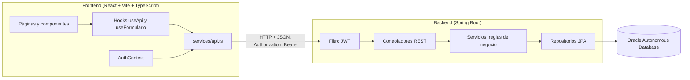
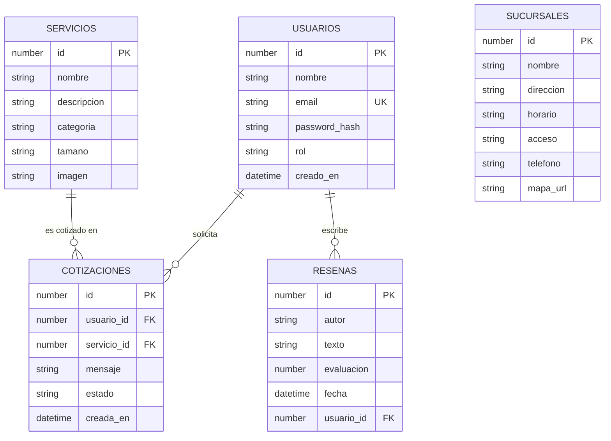
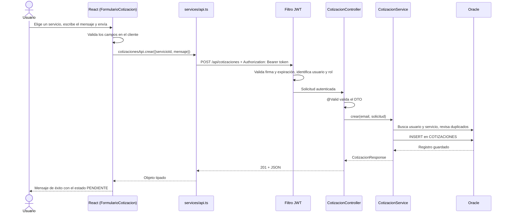
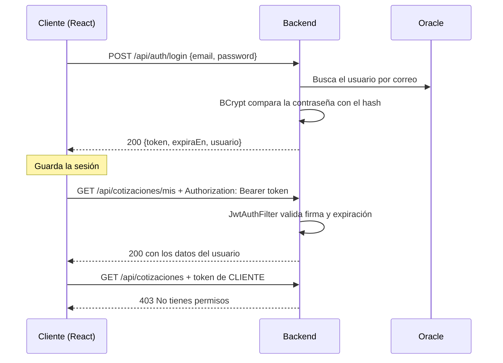
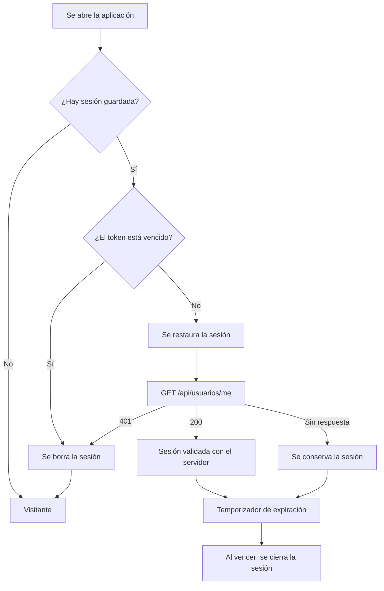

# Mi Espacio · Plataforma web de bodegas

Mi Espacio es una aplicación web para un servicio de arriendo de bodegas y lockers. Un cliente puede revisar el catálogo de espacios y las sucursales, registrarse, solicitar cotizaciones y dejar reseñas. El administrador del negocio gestiona los servicios y las sucursales y atiende las cotizaciones.

Este documento es el informe técnico de la **Evaluación Parcial N° 3 de DSY1104 Desarrollo Fullstack II** (integración de backend y frontend, RA3). Cada sección explica cómo se resolvió uno de los indicadores de la rúbrica, qué parte del código lo implementa y cómo comprobarlo.

## Índice

1. [Contexto y requerimientos del cliente](#1-contexto-y-requerimientos-del-cliente)
2. [Arquitectura general](#2-arquitectura-general)
3. [Backend: base de datos, modelos y lógica de negocio (IE3.1.1)](#3-backend-base-de-datos-modelos-y-lógica-de-negocio-ie311)
4. [API REST con Spring Boot y Swagger (IE3.2.1)](#4-api-rest-con-spring-boot-y-swagger-ie321)
5. [Integración entre frontend y backend (IE3.2.2)](#5-integración-entre-frontend-y-backend-ie322)
6. [Autenticación con roles y JWT (IE3.3.1)](#6-autenticación-con-roles-y-jwt-ie331)
7. [Gestión de sesiones en el frontend (IE3.3.2)](#7-gestión-de-sesiones-en-el-frontend-ie332)
8. [Cómo ejecutar el proyecto](#8-cómo-ejecutar-el-proyecto)
9. [Guion de demostración por indicador](#9-guion-de-demostración-por-indicador)
10. [Decisiones, límites y mejoras](#10-decisiones-límites-y-mejoras)
11. [Entregables y estructura del repositorio](#11-entregables-y-estructura-del-repositorio)

---

## 1. Contexto y requerimientos del cliente

El cliente es un negocio de almacenamiento que ya tenía un sitio informativo en HTML y CSS. En la Evaluación 2 ese sitio se migró a React. En esta evaluación se le agrega un backend real con base de datos, de modo que los datos dejan de estar escritos en el código y pasan a administrarse desde el sistema.

Los requerimientos que guían el diseño son los siguientes:

| Código | Requerimiento del cliente | Cómo lo resuelve el sistema |
| --- | --- | --- |
| RC-01 | Mostrar el catálogo de servicios de almacenamiento (locker, mini bodega, bodega grande y espacio a medida) con sus tamaños | Entidad `Servicio` y endpoints `/api/servicios` |
| RC-02 | Mostrar las sucursales con dirección, horario, acceso y mapa | Entidad `Sucursal` y endpoints `/api/sucursales` |
| RC-03 | Mostrar las opiniones de los clientes y permitir que los clientes registrados opinen | Entidad `Resena` y endpoints `/api/resenas` |
| RC-04 | Permitir que las personas se registren e inicien sesión | Entidad `Usuario`, endpoints `/api/auth` y tokens JWT |
| RC-05 | Permitir que un cliente solicite una cotización y revise su estado | Entidad `Cotizacion` y endpoints `/api/cotizaciones` |
| RC-06 | Permitir que el negocio administre servicios y sucursales y atienda las cotizaciones | Rol `ADMIN` y panel de administración |
| RC-07 | Proteger los datos: cada cliente solo ve lo suyo y solo el administrador modifica el catálogo | Roles, reglas por dueño y Spring Security |
| RC-08 | Guardar la información de forma persistente | Oracle Autonomous Database con JPA |

---

## 2. Arquitectura general

El sistema se divide en dos aplicaciones independientes que se comunican por HTTP y JSON: un frontend en React y un backend en Spring Boot que accede a Oracle.



| Capa | Tecnología | Para qué se usa |
| --- | --- | --- |
| Frontend | React 18, Vite, TypeScript, Bootstrap 5, React Router 6 | Interfaz, rutas y estado de sesión |
| Backend | Java 17, Spring Boot 3.3, Spring Web | API REST |
| Persistencia | Spring Data JPA con Hibernate | Mapeo de objetos a tablas |
| Seguridad | Spring Security y jjwt | Autenticación con JWT y autorización por rol |
| Validación | Jakarta Bean Validation | Reglas de formato en cada solicitud |
| Documentación | springdoc-openapi | Swagger UI |
| Base de datos | Oracle Autonomous Database (Wallet y TLS) | Almacenamiento. H2 en memoria como alternativa de desarrollo |

---

## 3. Backend: base de datos, modelos y lógica de negocio (IE3.1.1)

### 3.1 Cómo está organizado el backend

El backend sigue una arquitectura por capas. Cada capa tiene una sola responsabilidad, lo que permite cambiar una sin tocar las demás.

| Paquete (`cl.miespacio`) | Responsabilidad |
| --- | --- |
| `model` | Entidades JPA: representan las tablas de la base de datos |
| `repository` | Interfaces de Spring Data JPA: consultas y operaciones sobre las tablas |
| `service` | Reglas de negocio: deciden qué se puede hacer y qué no |
| `controller` | Endpoints REST: reciben la solicitud, delegan en el servicio y responden |
| `dto` | Objetos de entrada y salida de la API, con sus validaciones |
| `security` | Generación y validación de JWT |
| `config` | Configuración de seguridad, de Swagger y carga de datos iniciales |
| `exception` | Conversión de errores a respuestas JSON uniformes |

La API expone **DTO** y no las entidades. Así el hash de la contraseña nunca sale del servidor, los contratos de la API no dependen del diseño de las tablas y se evitan problemas de serialización con relaciones.

### 3.2 Modelo de datos



Cómo se tomaron las decisiones de modelado:

- **`Usuario`** guarda el correo como valor único y la contraseña solo como hash BCrypt (`password_hash`). El rol (`ADMIN` o `CLIENTE`) se guarda como texto, no como número, para que la tabla sea legible y no dependa del orden del enum.
- **`Servicio`** y **`Sucursal`** son el catálogo del negocio. Son datos que el cliente administra, por eso están en la base de datos y no en el código del frontend.
- **`Cotizacion`** es la entidad transaccional central. Une a un usuario con un servicio mediante dos claves foráneas obligatorias y tiene un estado (`PENDIENTE`, `ATENDIDA` o `RECHAZADA`) que representa el ciclo de vida de la solicitud.
- **`Resena`** guarda el nombre del autor además de la clave foránea al usuario. Las reseñas históricas del sitio original no tienen usuario (`usuario_id` es opcional), pero siguen mostrándose.
- Los identificadores son autonuméricos (`IDENTITY`). Las longitudes de las columnas coinciden con las validaciones de los DTO, así un dato que pasa la validación nunca falla al guardarse.

Con esto el modelo refleja los requerimientos: RC-01 y RC-02 en `Servicio` y `Sucursal`, RC-03 en `Resena`, RC-04 en `Usuario`, y RC-05 en `Cotizacion`.

### 3.3 Conexión a la base de datos

La conexión se define en `backend/src/main/resources/`:

- `application.properties` contiene la configuración común: puerto 8081, `ddl-auto=update` y los parámetros de JWT, CORS y administrador inicial, todos leídos de variables de entorno.
- `application-oracle.properties` se activa con el perfil `oracle` y define la conexión a Oracle: el alias de la wallet, el usuario y la contraseña desde `DB_USER` y `DB_PASSWORD`, el dialecto de Oracle y un pool de conexiones HikariCP.

```properties
spring.datasource.url=jdbc:oracle:thin:@a6etg25wwemt8hfb_low
spring.datasource.username=${DB_USER}
spring.datasource.password=${DB_PASSWORD}
spring.jpa.database-platform=org.hibernate.dialect.OracleDialect
spring.jpa.hibernate.ddl-auto=update
```

Oracle Autonomous Database exige una **wallet** (certificados TLS y alias de conexión). `MiEspacioApplication` la localiza al arrancar: sube por las carpetas del proyecto hasta encontrar `Wallet_A6ETG25WWEMT8HFB` y asigna su ruta a la propiedad `oracle.net.tns_admin`. Así el proyecto funciona sin depender de una ruta absoluta del computador de cada integrante.

Al iniciar, `ddl-auto=update` hace que Hibernate cree las tablas que falten a partir de las entidades. Después `DatosIniciales` carga, solo si las tablas están vacías, el catálogo de servicios, las sucursales con sus mapas, tres reseñas de ejemplo y el usuario administrador.

**Cómo confirmar que la conexión es correcta**

1. Al arrancar, la consola muestra `Wallet Oracle encontrada: ...` y `HikariPool-1 - Start completed`, y luego `Tomcat started on port 8081`.
2. En Database Actions (o SQL Developer) ejecuta:
   ```sql
   SELECT COUNT(*) FROM MIESPACIO.SERVICIOS;
   SELECT ID, NOMBRE, EMAIL, ROL FROM MIESPACIO.USUARIOS;
   ```
3. Registra un usuario desde la web y repite la segunda consulta: el usuario nuevo aparece con su contraseña en formato hash (`$2a$...`).

### 3.4 Lógica de negocio

La lógica vive en la capa `service`. Cada regla responde a un problema concreto del cliente:

| Regla | Problema que resuelve | Dónde | Si no se cumple |
| --- | --- | --- | --- |
| El correo es único (sin distinguir mayúsculas) y se guarda en minúsculas | Evitar cuentas duplicadas | `AuthService.registrar` | 409 |
| Todo registro público crea un usuario `CLIENTE` | Nadie puede darse a sí mismo permisos de administrador | `AuthService.registrar` | No aplica |
| Un usuario no puede tener dos cotizaciones `PENDIENTE` del mismo servicio | Evitar solicitudes repetidas que saturen al negocio | `CotizacionService.crear` | 409 |
| Una cotización solo se modifica mientras está `PENDIENTE` | Una solicitud ya atendida es un registro cerrado | `CotizacionService.actualizar` | 409 |
| El cliente solo edita el mensaje y el administrador solo cambia el estado a `ATENDIDA` o `RECHAZADA` | Separar quién pide de quién resuelve | `CotizacionService.actualizar` | 403 o 400 |
| Un cliente solo ve y elimina sus propias cotizaciones, y solo si están pendientes | Privacidad de los datos de cada cliente | `CotizacionService.obtener` y `eliminar` | 403 |
| Cada usuario publica una sola reseña; solo su autor o un administrador la edita o elimina | Evitar spam y manipulación de opiniones | `ResenaService` | 409 o 403 |
| No se elimina un servicio que tiene cotizaciones asociadas | No dejar cotizaciones sin servicio ni perder historial | `ServicioService.eliminar` | 409 |
| Al eliminar un usuario se eliminan sus cotizaciones y reseñas, y no se puede eliminar la propia cuenta | Mantener la integridad de los datos y evitar que el administrador se bloquee | `UsuarioService.eliminar` | 409 |

Un ejemplo de cómo se implementa una de estas reglas:

```java
if (repositorio.existsByUsuario_IdAndServicio_IdAndEstado(
        usuario.getId(), servicio.getId(), EstadoCotizacion.PENDIENTE)) {
    throw new ResponseStatusException(HttpStatus.CONFLICT,
            "Ya tienes una cotización pendiente para este servicio.");
}
```

Además de las reglas de negocio, cada solicitud pasa por **validación de formato** con Bean Validation en los DTO. Por ejemplo, el mensaje de una cotización debe tener entre 10 y 200 caracteres y la evaluación de una reseña debe estar entre 1 y 5.

### 3.5 Manejo uniforme de errores

`ManejadorErrores` convierte cualquier error en una respuesta JSON con el mismo formato, de modo que el frontend siempre sabe cómo leerlo:

```json
{ "status": 409, "mensaje": "Ya tienes una cotización pendiente para este servicio." }
```

Los errores de validación incluyen además el detalle por campo en `errores`.

---

## 4. API REST con Spring Boot y Swagger (IE3.2.1)

### 4.1 Cómo se implementó

Cada recurso tiene un `@RestController` delgado que solo traduce HTTP a llamadas al servicio. Los controladores no contienen reglas de negocio. Un ejemplo con el recurso de servicios:

```java
@RestController
@RequestMapping("/api/servicios")
@Tag(name = "Servicios", description = "Catálogo de lockers y bodegas (lectura pública, escritura solo ADMIN)")
public class ServicioController {

    @GetMapping
    @Operation(summary = "Lista todos los servicios")
    public List<ServicioResponse> listar() { return servicios.listar(); }

    @PostMapping
    @ResponseStatus(HttpStatus.CREATED)
    @PreAuthorize("hasRole('ADMIN')")
    @Operation(summary = "Crea un servicio (ADMIN)")
    public ServicioResponse crear(@Valid @RequestBody ServicioRequest r) { return servicios.crear(r); }
}
```

- `@RequestMapping`, `@GetMapping`, `@PostMapping`, `@PutMapping` y `@DeleteMapping` asocian cada operación CRUD a un método HTTP.
- `@Valid` activa las validaciones del DTO antes de entrar a la lógica.
- `@ResponseStatus` fija el código correcto: 201 al crear y 204 al eliminar.
- `@PreAuthorize` restringe las operaciones de escritura al rol administrador.

### 4.2 Endpoints creados

Los cuatro recursos principales tienen CRUD completo: lectura (`GET`), creación (`POST`), actualización (`PUT`) y eliminación (`DELETE`).

**Autenticación**

| Método y ruta | Acceso | Éxito | Errores |
| --- | --- | --- | --- |
| `POST /api/auth/registro` | Público | 201 | 400, 409 |
| `POST /api/auth/login` | Público | 200 | 400, 401 |

**Servicios** (`/api/servicios`)

| Operación | Método y ruta | Acceso | Éxito | Errores |
| --- | --- | --- | --- | --- |
| Listar | `GET /api/servicios` | Público | 200 | |
| Leer uno | `GET /api/servicios/{id}` | Público | 200 | 404 |
| Crear | `POST /api/servicios` | ADMIN | 201 | 400, 401, 403 |
| Actualizar | `PUT /api/servicios/{id}` | ADMIN | 200 | 400, 401, 403, 404 |
| Eliminar | `DELETE /api/servicios/{id}` | ADMIN | 204 | 401, 403, 404, 409 |

**Sucursales** (`/api/sucursales`): mismas operaciones, métodos, accesos y códigos que servicios.

**Reseñas** (`/api/resenas`)

| Operación | Método y ruta | Acceso | Éxito | Errores |
| --- | --- | --- | --- | --- |
| Listar | `GET /api/resenas` | Público | 200 | |
| Leer una | `GET /api/resenas/{id}` | Público | 200 | 404 |
| Crear | `POST /api/resenas` | Sesión | 201 | 400, 401, 409 |
| Actualizar | `PUT /api/resenas/{id}` | Autor o ADMIN | 200 | 400, 401, 403, 404 |
| Eliminar | `DELETE /api/resenas/{id}` | Autor o ADMIN | 204 | 401, 403, 404 |

**Cotizaciones** (`/api/cotizaciones`)

| Operación | Método y ruta | Acceso | Éxito | Errores |
| --- | --- | --- | --- | --- |
| Crear | `POST /api/cotizaciones` | Sesión | 201 | 400, 401, 404, 409 |
| Listar las propias | `GET /api/cotizaciones/mis` | Sesión | 200 | 401 |
| Listar todas | `GET /api/cotizaciones` | ADMIN | 200 | 401, 403 |
| Leer una | `GET /api/cotizaciones/{id}` | Dueño o ADMIN | 200 | 403, 404 |
| Actualizar | `PUT /api/cotizaciones/{id}` | Dueño (mensaje) o ADMIN (estado) | 200 | 400, 403, 404, 409 |
| Eliminar | `DELETE /api/cotizaciones/{id}` | Dueño (si está pendiente) o ADMIN | 204 | 403, 404, 409 |

**Usuarios** (`/api/usuarios`)

| Operación | Método y ruta | Acceso | Éxito | Errores |
| --- | --- | --- | --- | --- |
| Ver mi perfil | `GET /api/usuarios/me` | Sesión | 200 | 401 |
| Listar | `GET /api/usuarios` | ADMIN | 200 | 401, 403 |
| Eliminar | `DELETE /api/usuarios/{id}` | ADMIN | 204 | 404, 409 |

Un ejemplo completo de creación (`POST /api/servicios`, con el token del administrador):

```json
{
  "nombre": "Bodega XL",
  "descripcion": "Bodega de gran tamaño para inventario y mercadería.",
  "categoria": "Bodega grande",
  "tamano": "5mt x 5mt",
  "imagen": "/img/bodega-grande.jpg"
}
```

Respuesta `201 Created`:

```json
{ "id": 5, "nombre": "Bodega XL", "descripcion": "Bodega de gran tamaño para inventario y mercadería.",
  "categoria": "Bodega grande", "tamano": "5mt x 5mt", "imagen": "/img/bodega-grande.jpg" }
```

### 4.3 Cómo se documentaron los endpoints en Swagger

- La dependencia `springdoc-openapi-starter-webmvc-ui` genera la especificación OpenAPI a partir de los controladores y publica Swagger UI.
- Cada controlador lleva `@Tag` (agrupa los endpoints por recurso) y cada método lleva `@Operation(summary = ...)`, de modo que cada endpoint aparece con una descripción clara y su regla de acceso.
- `OpenApiConfig` declara un esquema de seguridad `bearerAuth` de tipo JWT. Eso habilita el botón **Authorize**, con el que se pega el token y se prueban los endpoints protegidos desde el navegador.

Para verlos: `http://localhost:8081/swagger-ui.html`. La especificación en formato JSON está en `http://localhost:8081/v3/api-docs`.

### 4.4 Cómo comprobar que el CRUD funciona

1. En Swagger, ejecuta `POST /api/auth/login`, copia el `token` y pégalo en **Authorize**.
2. Ejecuta `POST /api/servicios` (201), luego `GET /api/servicios/{id}` (200), `PUT /api/servicios/{id}` (200) y `DELETE /api/servicios/{id}` (204).
3. Repite `GET /api/servicios/{id}`: ahora responde 404, lo que confirma la eliminación.
4. Confirma en la base de datos con `SELECT * FROM MIESPACIO.SERVICIOS`.

---

## 5. Integración entre frontend y backend (IE3.2.2)

### 5.1 Qué significa la integración en este proyecto

En la Evaluación 2 el frontend mostraba datos escritos en el código. Ahora no guarda ningún dato de negocio: todo lo que ve el usuario viene de la API y todo lo que el usuario hace se envía a la API. El contrato entre ambos es el JSON de los DTO.

### 5.2 Flujo de datos

El flujo de una operación completa, por ejemplo **solicitar una cotización**:



Paso a paso:

1. El usuario completa el formulario. React valida el formato en el cliente para dar respuesta inmediata, sin enviar nada a la red si hay errores.
2. El componente llama a un método de `services/endpoints.ts`, que delega en `services/api.ts`.
3. `api.ts` agrega la cabecera `Authorization: Bearer <token>` con el token de la sesión y envía el JSON.
4. En el backend, el filtro JWT valida el token y reconoce al usuario y su rol.
5. El controlador valida el DTO (`@Valid`) y llama al servicio.
6. El servicio aplica las reglas de negocio y el repositorio guarda en Oracle.
7. La respuesta vuelve como DTO. Si hubo un error, vuelve con el formato `{ status, mensaje }`.
8. `api.ts` convierte la respuesta en un objeto tipado o en un `ErrorApi`, y el componente muestra el resultado.

El flujo de lectura es más corto: una pantalla como Servicios usa el hook `useApi`, que llama a `GET /api/servicios`, mantiene los estados `cargando` y `error` y entrega los datos al componente.

### 5.3 Cómo se implementó en el frontend

| Archivo | Función |
| --- | --- |
| `services/api.ts` | Cliente HTTP único: agrega el token, convierte las respuestas a JSON, normaliza los errores en `ErrorApi` y detecta el 401 |
| `services/endpoints.ts` | Un módulo por recurso (`serviciosApi`, `cotizacionesApi`, `resenasApi`, `authApi`...) con funciones tipadas |
| `hooks/useApi.ts` | Hook de carga de datos con estados `datos`, `cargando` y `error` |
| `hooks/useFormulario.ts` | Estado, validación y envío de formularios |
| `components/molecules/EstadoCarga.tsx` | Muestra "Cargando..." o el error de forma uniforme |
| `types/` | Interfaces TypeScript equivalentes a los DTO del backend |
| `config.ts` | URL base de la API (`VITE_API_URL`, por defecto `http://localhost:8081`) |

```ts
const solicitar = async <T>(ruta: string, metodo: string, cuerpo?: unknown): Promise<T> => {
  const cabeceras: Record<string, string> = {}
  if (cuerpo !== undefined) cabeceras['Content-Type'] = 'application/json'
  const sesion = leerSesion()
  if (sesion) cabeceras.Authorization = `Bearer ${sesion.token}`
  const respuesta = await fetch(`${API_URL}${ruta}`, { method: metodo, headers: cabeceras,
    body: cuerpo === undefined ? undefined : JSON.stringify(cuerpo) })
  // ...convierte la respuesta o lanza ErrorApi con el mensaje del backend
}
```

### 5.4 Qué pantalla usa qué endpoint

| Pantalla | Ruta del frontend | Endpoints |
| --- | --- | --- |
| Servicios | `/servicios` | `GET /api/servicios` |
| Detalle de servicio | `/servicios/:id` | `GET /api/servicios/{id}` |
| Sucursales | `/sucursales` | `GET /api/sucursales` |
| Reseñas | `/resenas` | `GET`, `POST` y `DELETE /api/resenas` |
| Iniciar sesión | `/login` | `POST /api/auth/login` |
| Registrarse | `/registro` | `POST /api/auth/registro` |
| Cotiza aquí | `/cotiza` | `GET /api/servicios` y `POST /api/cotizaciones` |
| Mis cotizaciones | `/mis-cotizaciones` | `GET /api/cotizaciones/mis` y `DELETE /api/cotizaciones/{id}` |
| Administración | `/admin` | CRUD de `/api/servicios`, `GET /api/cotizaciones`, `PUT` y `DELETE /api/cotizaciones/{id}` |
| Carga de la sesión | (al abrir la app) | `GET /api/usuarios/me` |
| Contacto | `/contacto` | Ninguno: el formulario valida en el cliente y no envía datos |

### 5.5 Por qué la integración es efectiva y eficiente

- **Un solo punto de comunicación.** Toda la red pasa por `api.ts`: la URL base, el token y el manejo de errores se definen una vez, y no se repiten en cada componente.
- **Contrato tipado en ambos lados.** Las interfaces TypeScript reflejan los DTO del backend. Si un campo cambia, el error aparece al compilar y no en producción.
- **Cada pantalla hace las solicitudes que necesita y nada más.** Una pantalla de lectura hace una solicitud; no se descargan datos que no se muestran.
- **Respuestas obsoletas descartadas.** `useApi` ignora la respuesta de una solicitud si el usuario ya cambió de pantalla, lo que evita mostrar datos viejos o actualizar componentes desmontados.
- **Errores comprensibles.** El backend devuelve siempre `{ status, mensaje }` y el frontend lo transforma en un mensaje para el usuario, incluso cuando el servidor no responde.
- **Doble validación.** El frontend valida para responder rápido y el backend vuelve a validar porque no puede confiar en el cliente.
- **CORS acotado.** Solo se permite el origen del frontend, los métodos usados y las cabeceras `Authorization` y `Content-Type`.
- **Sin datos sensibles en la respuesta.** Los DTO nunca incluyen el hash de la contraseña.

### 5.6 Cómo comprobar que se comunican correctamente

1. Con ambos servicios en ejecución, abre `/servicios` y revisa en las herramientas del navegador (pestaña Red) la solicitud `GET /api/servicios` con respuesta 200.
2. Inicia sesión y solicita una cotización: en la pestaña Red aparece `POST /api/cotizaciones` con la cabecera `Authorization` y respuesta 201.
3. Entra a Mis cotizaciones y compara el resultado con `GET /api/cotizaciones/mis` en Swagger.
4. Apaga el backend y recarga: el frontend muestra "No se pudo conectar con el servidor", lo que confirma que los datos dependen de la API.

---

## 6. Autenticación con roles y JWT (IE3.3.1)

### 6.1 Flujo de autenticación



### 6.2 El token

`JwtService` emite un JWT firmado con HMAC. La clave de firma sale de la variable de entorno `JWT_SECRET` (mínimo 32 caracteres) y el token contiene:

| Campo | Contenido |
| --- | --- |
| `sub` | Correo del usuario |
| `rol` | `ADMIN` o `CLIENTE` |
| `uid` | Identificador del usuario |
| `iat` y `exp` | Fecha de emisión y de expiración (60 minutos por defecto, configurable con `JWT_EXPIRACION_MINUTOS`) |

```java
return Jwts.builder()
        .subject(usuario.getEmail())
        .claim("rol", usuario.getRol().name())
        .claim("uid", usuario.getId())
        .issuedAt(ahora)
        .expiration(new Date(ahora.getTime() + expiracionMs))
        .signWith(clave)
        .compact();
```

Si `JWT_SECRET` no está definida, el backend genera una clave aleatoria temporal y avisa en el log; en ese caso los tokens dejan de valer al reiniciar.

### 6.3 Cómo se valida cada solicitud

`JwtAuthFilter` se ejecuta antes de los controladores. Lee la cabecera `Authorization`, valida la firma y la expiración del token, y registra en Spring Security al usuario con la autoridad `ROLE_ADMIN` o `ROLE_CLIENTE`. Si el token falta, es inválido o expiró, la solicitud sigue sin autenticación y las reglas de acceso la rechazan con 401.

Detalle técnico: el filtro se crea con `new` dentro de la cadena de seguridad y no como `@Bean`. Así Spring Boot no lo registra una segunda vez como filtro de servlet, lo que provocaría que la autenticación se perdiera.

### 6.4 Reglas de autorización

`SecurityConfig` define la política en dos niveles. El primero son las rutas:

```java
.authorizeHttpRequests(a -> a
    .requestMatchers("/swagger-ui.html", "/swagger-ui/**", "/v3/api-docs/**").permitAll()
    .requestMatchers("/api/auth/**").permitAll()
    .requestMatchers(HttpMethod.GET, "/api/servicios/**", "/api/sucursales/**", "/api/resenas/**").permitAll()
    .anyRequest().authenticated())
```

El segundo son los permisos por rol en cada endpoint (`@PreAuthorize("hasRole('ADMIN')")`) y las reglas por dueño en la capa de servicio (por ejemplo, un cliente solo ve sus cotizaciones).

| Acción | Visitante | CLIENTE | ADMIN |
| --- | :---: | :---: | :---: |
| Ver catálogo, sucursales y reseñas | ✔ | ✔ | ✔ |
| Registrarse e iniciar sesión | ✔ | ✔ | ✔ |
| Solicitar cotizaciones y ver las propias | | ✔ | ✔ |
| Publicar una reseña y eliminar la propia | | ✔ | ✔ |
| Crear, editar y eliminar servicios y sucursales | | | ✔ |
| Ver todas las cotizaciones y cambiar su estado | | | ✔ |
| Listar y eliminar usuarios, eliminar cualquier reseña | | | ✔ |

### 6.5 Otras medidas de seguridad

- **Contraseñas con BCrypt.** Nunca se guardan ni se devuelven en texto plano.
- **Mensaje genérico en el login.** Tanto un correo inexistente como una contraseña incorrecta responden "Correo o contraseña incorrectos", para no revelar qué correos están registrados.
- **Sesión sin estado.** El backend no guarda sesiones en memoria: cada solicitud se valida por su token. Por eso se desactiva CSRF, ya que el token viaja en una cabecera y no en una cookie.
- **Respuestas 401 y 403 en JSON** con un mensaje claro, en lugar de páginas HTML.
- **Sin credenciales en el código.** La base de datos, la clave del token y la contraseña del administrador llegan por variables de entorno.

### 6.6 Cómo comprobarlo

1. Llama a `GET /api/cotizaciones` sin token: responde **401**.
2. Inicia sesión como cliente y repite la llamada con su token: responde **403**.
3. Inicia sesión como administrador y repite: responde **200** con todas las cotizaciones.
4. Edita un carácter del token y repite: responde **401**, porque la firma ya no coincide.

---

## 7. Gestión de sesiones en el frontend (IE3.3.2)

### 7.1 Estrategia

La sesión es el par token y usuario que devuelve el login. Se guarda en `localStorage` bajo la clave `mi-espacio.sesion` y se administra desde un contexto de React (`AuthContext`) que expone a toda la aplicación el usuario actual, si es administrador y las acciones de iniciar y cerrar sesión.

Se eligió `localStorage` porque cumple lo que pide el indicador: la sesión **persiste al recargar la página** y al abrir otras pestañas. Su riesgo (el robo del token mediante XSS) se trata en la sección 7.5.

### 7.2 Ciclo de vida de la sesión



### 7.3 Cómo se implementó

`services/sesion.ts` guarda, lee y borra la sesión. Al leerla descarta automáticamente un token vencido:

```ts
export const leerSesion = (): Sesion | null => {
  const crudo = localStorage.getItem(CLAVE_SESION)
  if (!crudo) return null
  const sesion = JSON.parse(crudo) as Sesion
  if (!sesion.token || !sesion.usuario || sesion.expiraEn <= Date.now()) {
    localStorage.removeItem(CLAVE_SESION)
    return null
  }
  return sesion
}
```

`ProveedorAuth` (en `context/AuthContext.tsx`) resuelve el resto:

| Situación | Qué hace |
| --- | --- |
| Se recarga la página | Restaura la sesión desde `localStorage` antes de dibujar la pantalla |
| Hay sesión guardada | Consulta `GET /api/usuarios/me` para confirmar que el token sigue siendo válido. Si el servidor responde 401, cierra la sesión; si no responde, la conserva |
| El token expira | Un temporizador cierra la sesión automáticamente en el instante de expiración |
| Cualquier llamada autenticada recibe 401 | `api.ts` borra la sesión y avisa al contexto, que actualiza la interfaz |
| Se inicia o cierra sesión en otra pestaña | El evento `storage` sincroniza el estado entre pestañas |

### 7.4 Rutas protegidas e interfaz según la sesión

`RutaProtegida` envuelve las rutas que requieren sesión o un rol:

```tsx
<Route path="/cotiza" element={<RutaProtegida><Cotiza /></RutaProtegida>} />
<Route path="/admin"  element={<RutaProtegida roles={['ADMIN']}><Admin /></RutaProtegida>} />
```

- Sin sesión, redirige a `/login` y recuerda la página de origen: tras iniciar sesión, el usuario vuelve a donde quería ir.
- Con sesión pero sin el rol requerido, muestra "Acceso denegado".
- Mientras se valida la sesión al cargar, muestra "Verificando sesión..." para evitar un parpadeo hacia el login.

El encabezado también cambia según la sesión: muestra el nombre del usuario y **Cerrar sesión**, y agrega los enlaces **Mis cotizaciones** y, solo para el administrador, **Administración**.

### 7.5 Riesgos y mitigaciones

El riesgo principal de `localStorage` es que un ataque XSS podría leer el token. Se reduce con estas medidas:

- React escapa el contenido por defecto y el proyecto no usa `dangerouslySetInnerHTML`.
- El token expira en 60 minutos y se puede revocar cerrando sesión.
- Cada solicitud se valida en el servidor: la protección real está en el backend, no en el frontend. Ocultar un botón o una ruta es solo comodidad para el usuario.

La alternativa más segura sería una cookie `HttpOnly` con protección CSRF. Exige más configuración en el servidor y se deja como mejora futura (sección 10).

### 7.6 Cómo comprobarlo

1. Inicia sesión y recarga la página con `F5`: la sesión se mantiene.
2. Abre otra pestaña en la misma dirección: ya aparece con sesión iniciada.
3. Cierra sesión en una pestaña: la otra también se cierra.
4. Entra a `/cotiza` sin sesión: te lleva a `/login` y, tras ingresar, vuelves a `/cotiza`.
5. Entra a `/admin` con una cuenta de cliente: aparece "Acceso denegado".
6. En las herramientas del navegador (Aplicación → Almacenamiento local) se ve la clave `mi-espacio.sesion`; modifica `expiraEn` a una fecha pasada, recarga y la sesión se cierra.

---

## 8. Cómo ejecutar el proyecto

### Requisitos

- JDK 17 o superior y Maven 3.9 o superior
- Node.js 18 o superior
- La carpeta de la wallet de Oracle dentro de `backend/` (`Wallet_A6ETG25WWEMT8HFB`). No forma parte del repositorio por seguridad y se entrega por un canal privado.

### Backend (puerto 8081)

PowerShell:

```powershell
cd backend
$env:SPRING_PROFILES_ACTIVE = "oracle"
$env:DB_USER = "<usuario de la base de datos>"
$env:DB_PASSWORD = "<contraseña de la base de datos>"
$env:JWT_SECRET = "<texto aleatorio de al menos 32 caracteres>"
$env:ADMIN_PASSWORD = "<contraseña del administrador inicial>"
mvn spring-boot:run
```

Linux o macOS:

```bash
cd backend
export SPRING_PROFILES_ACTIVE=oracle
export DB_USER='<usuario de la base de datos>'
export DB_PASSWORD='<contraseña de la base de datos>'
export JWT_SECRET="$(openssl rand -base64 48)"
export ADMIN_PASSWORD='<contraseña del administrador inicial>'
mvn spring-boot:run
```

| Variable | Descripción |
| --- | --- |
| `SPRING_PROFILES_ACTIVE` | `oracle` para usar Oracle. Sin ella se usa H2 en memoria |
| `DB_USER`, `DB_PASSWORD` | Credenciales de la base de datos (perfil `oracle`) |
| `JWT_SECRET` | Clave de firma del token, de al menos 32 caracteres |
| `ADMIN_EMAIL` | Correo del administrador inicial (por defecto `admin@miespacio.cl`) |
| `ADMIN_PASSWORD` | Contraseña del administrador inicial. Si falta, se genera y se imprime una sola vez en la consola. Solo se aplica si el administrador aún no existe |
| `JWT_EXPIRACION_MINUTOS` | Duración del token (por defecto 60) |
| `CORS_ORIGENES` | Orígenes permitidos separados por coma (por defecto `http://localhost:8080`) |

Swagger UI queda disponible en `http://localhost:8081/swagger-ui.html`.

### Frontend

```bash
cd frontend
npm install
npm run dev -- --port 8080
```

El puerto 8080 coincide con el origen que el backend permite por defecto. Si prefieres el puerto 5173 de Vite, define `CORS_ORIGENES=http://localhost:5173` antes de iniciar el backend. La URL de la API es `http://localhost:8081` por defecto; para cambiarla, crea `frontend/.env` con `VITE_API_URL=<url>`.

---

## 9. Guion de demostración por indicador

Una secuencia para la presentación, de unos diez minutos:

1. **Arquitectura (1 min).** Muestra el diagrama de la sección 2 y explica el recorrido de una solicitud, desde React hasta Oracle.
2. **IE3.1.1: base de datos y modelos (2 min).** Muestra el diagrama entidad-relación y las tablas en Oracle con datos. Explica dos reglas de negocio: la cotización pendiente duplicada y el servicio con cotizaciones que no se puede eliminar.
3. **IE3.2.1: API y Swagger (2 min).** Abre Swagger, muestra los endpoints agrupados y ejecuta un CRUD completo con el token del administrador. Confirma en la base de datos.
4. **IE3.2.2: integración (2 min).** En la web, solicita una cotización con la pestaña Red abierta y muestra la solicitud, su cabecera `Authorization` y la respuesta. Verifica que el dato aparece en Oracle.
5. **IE3.3.1: JWT y roles (2 min).** Llama a `GET /api/cotizaciones` sin token (401), con un cliente (403) y con el administrador (200). Explica el contenido del token.
6. **IE3.3.2: sesión (1 min).** Recarga la página con sesión iniciada, intenta entrar a `/admin` como cliente y cierra sesión.

---

## 10. Decisiones, límites y mejoras

- **Token en `localStorage`.** Se priorizó la persistencia de la sesión pedida por la rúbrica. Una cookie `HttpOnly` con protección CSRF sería más segura.
- **`ddl-auto=update`.** Crea y ajusta las tablas automáticamente, útil en desarrollo. En producción se usarían migraciones controladas (Flyway o Liquibase).
- **El formulario de Contacto no envía datos.** Solo valida en el cliente porque el caso no define un recurso de mensajes en el backend. Sería una mejora natural.
- **Sin pruebas automatizadas.** La verificación es manual (Swagger, navegador y base de datos). Se recomienda agregar pruebas de integración con `MockMvc` y pruebas de componentes en el frontend.
- **La wallet y los secretos no están en el repositorio.** Quien clone el proyecto necesita la wallet y las variables de entorno para ejecutarlo con Oracle.
- **El administrador inicial se crea una sola vez.** Si ya existe, cambiar `ADMIN_PASSWORD` no modifica su contraseña.

---

## 11. Entregables y estructura del repositorio

- [x] Enlace de GitHub público del proyecto
- [x] Manual de usuario con pantallazos: [`docs/MANUAL_DE_USUARIO.md`](docs/MANUAL_DE_USUARIO.md)
- [x] Documento complementario de integración y rúbrica: [`docs/INTEGRACION_Y_RUBRICA.md`](docs/INTEGRACION_Y_RUBRICA.md)

```
mi-espacio-fullstack/
├── backend/
│   ├── pom.xml
│   └── src/main/
│       ├── java/cl/miespacio/
│       │   ├── config/        SecurityConfig, OpenApiConfig, DatosIniciales
│       │   ├── controller/    Auth, Servicio, Sucursal, Resena, Cotizacion, Usuario
│       │   ├── dto/           Solicitudes y respuestas con validación
│       │   ├── exception/     ManejadorErrores
│       │   ├── model/         Usuario, Servicio, Sucursal, Resena, Cotizacion
│       │   ├── repository/    Repositorios Spring Data JPA
│       │   ├── security/      JwtService, JwtAuthFilter, Sesion
│       │   └── service/       Lógica de negocio
│       └── resources/         application.properties y application-oracle.properties
├── frontend/
│   └── src/
│       ├── components/        atoms · molecules · organisms (Atomic Design)
│       ├── context/           AuthContext
│       ├── hooks/             useApi, useFormulario
│       ├── pages/             Páginas
│       ├── services/          api.ts, endpoints.ts, sesion.ts
│       └── types/             Contratos TypeScript
└── docs/
```

## Equipo

- Daniel Azócar
- _(agregar a los demás integrantes)_
